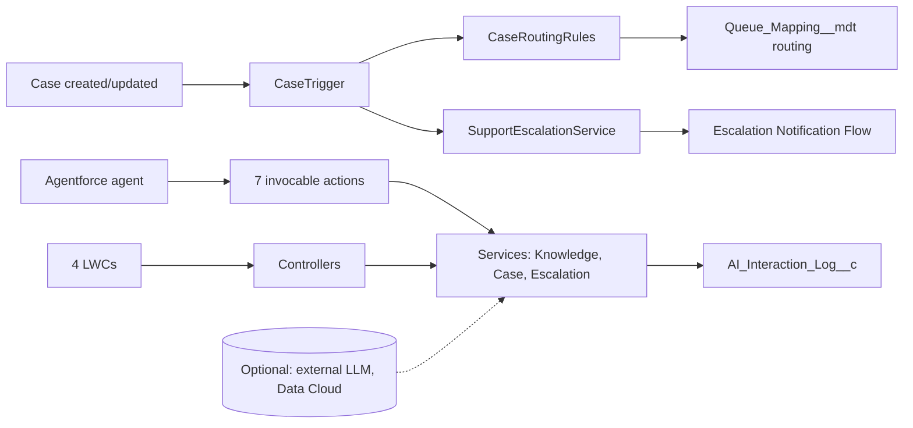

# SmartSupport AI - Agentforce-powered customer service automation (Salesforce DX)

A portfolio-grade Salesforce DX project: deterministic case triage, safe Knowledge retrieval, escalation and audit logging, exposed to **Agentforce** through seven Apex invocable actions and to people through four Lightning Web Components. The core runs on a Service Cloud org **without** Agentforce, Data Cloud or any LLM licence; those are optional layers.


## Architecture

Details: `docs/architecture.md`.

## What is included
- **Data model**: 10 Case fields, `Account.Support_Tier__c`, `AI_Interaction_Log__c`, two custom metadata types (queue mapping, settings), 8 queues, custom notification type.
- **Rules (deterministic)**: outage -> urgent; breach/unauthorized access -> security path; billing; login/account access distinct from technical; queue routing via `Queue_Mapping__mdt` (no hard-coded Ids); human request and repeated failure -> handoff; missing knowledge -> "insufficient evidence", never invented answers; no duplicate notifications.
- **Apex**: services, trigger handler, 7 Agentforce actions (`AgentActionSearchKnowledge`, `...ClassifyCase`, `...SummarizeCase`, `...GetCaseStatus`, `...CreateCase`, `...AddComment`, `...EscalateCase`), 2 Flow actions, 2 LWC controllers, 12 test classes (134 test methods).
- **Flows (3)**: Case Intake, Escalation Notification, AI Assisted Resolution (screen flow, human in the loop). Deployed as Draft.
- **LWC (4)**: `smartSupportDashboard`, `caseIntelligencePanel`, `knowledgeAssistant`, `caseActionPanel` (+ `supportUtils`), with 23 Jest tests.
- **Security**: USER_MODE, FLS, sharing, input validation, prompt-injection safeguards, PII-scrubbed logging, human approval, no authorization by case number alone.
- **Optional modules**: `optional/external-llm` (HttpCalloutMock-tested REST integration via Named Credential), Data Cloud/Prompt Builder guidance in `docs/agentforce-setup.md`.

## Quick start (macOS/Linux)
```bash
npm install                                  # LWC Jest tooling
npm run test:unit                            # LWC tests (no org needed)
python3 scripts/validate_project.py          # offline consistency checks
sf org login web --alias smartsupport
sf project deploy validate --manifest manifest/package.xml --target-org smartsupport --test-level RunSpecifiedTests --tests AIInteractionLogServiceTest --tests AgentforceActionsTest --tests CaseActionServiceTest --tests CaseIntelligenceServiceTest --tests CaseRoutingRulesTest --tests CaseTriggerHandlerTest --tests CustomerContextServiceTest --tests FlowActionsTest --tests KnowledgeSearchServiceTest --tests QueueRoutingServiceTest --tests SupportControllersTest --tests SupportEscalationServiceTest
sf project deploy start    --manifest manifest/package.xml --target-org smartsupport --test-level RunSpecifiedTests --tests AIInteractionLogServiceTest --tests AgentforceActionsTest --tests CaseActionServiceTest --tests CaseIntelligenceServiceTest --tests CaseRoutingRulesTest --tests CaseTriggerHandlerTest --tests CustomerContextServiceTest --tests FlowActionsTest --tests KnowledgeSearchServiceTest --tests QueueRoutingServiceTest --tests SupportControllersTest --tests SupportEscalationServiceTest
sf org assign permset --name SmartSupport_Admin --target-org smartsupport
sf apex run test --target-org smartsupport --class-names AIInteractionLogServiceTest,AgentforceActionsTest,CaseActionServiceTest,CaseIntelligenceServiceTest,CaseRoutingRulesTest,CaseTriggerHandlerTest,CustomerContextServiceTest,FlowActionsTest,KnowledgeSearchServiceTest,QueueRoutingServiceTest,SupportControllersTest,SupportEscalationServiceTest --code-coverage --result-format human --wait 20
```
Or use `scripts/deploy.sh smartsupport` and `scripts/run-tests.sh smartsupport`.

## Windows (PowerShell)
```powershell
npm install
npm run test:unit
sf org login web --alias smartsupport
.\scripts\deploy.ps1 -Org smartsupport -CheckOnly
.\scripts\deploy.ps1 -Org smartsupport
.\scripts\run-tests.ps1 -Org smartsupport
```
`python3` may be `py -3` on Windows. If script execution is blocked: `Set-ExecutionPolicy -Scope Process Bypass`.

## Load sample data (fictional)
Order: deploy -> assign permission set -> add users to the queues -> (optional) create Knowledge articles -> data.
```bash
sf data import bulk --sobject Account --file data/accounts.csv --wait 10 --target-org smartsupport
sf data import bulk --sobject Contact --file data/contacts.csv --wait 10 --target-org smartsupport
sf data import bulk --sobject Case    --file data/cases.csv    --wait 10 --target-org smartsupport
```
CSV contacts/cases are not linked to accounts. For linked records use `sf apex run --file scripts/apex/load-sample-data.apex --target-org smartsupport`. Knowledge samples: `data/knowledge-samples/README.md`. The Case trigger classifies the loaded cases.

## What is automated versus what must be configured manually
| Automated by the deployment | Manual |
|---|---|
| Fields, object, validation rules, custom metadata, queues, notification type, permission sets, flows (Draft), LWCs, app, tab, Lightning page | Assign permission sets; add users to queues; **activate the 3 flows**; enable the custom notification type for users; add the SmartSupport app/home page to your profile if needed |
| Apex rules, triggers, actions, tests | Enable Lightning Knowledge and create articles (no import file) |
| | Agentforce agent, topics, actions, Prompt Builder template (`docs/agentforce-setup.md`) |
| | Data Cloud (optional); external LLM Named Credential (optional, `optional/external-llm/README.md`) |
| | Reports/dashboards (none are shipped; build from `AI_Interaction_Log__c` and Case fields) |

## API version
`sourceApiVersion` is 65.0 (Salesforce Winter '26). If your org is older, lower it in `sfdx-project.json`, `manifest/package.xml` and every `*-meta.xml`, then re-validate.

## How to demonstrate this project in an interview
1. **Frame** (1 min): deterministic-first, AI-assisted; the core works without AI licences.
2. **Create cases live**: outage -> High/Urgent queue/notification; billing dispute; security incident -> Security_Response; "I want a human".
3. **Show the audit trail**: `AI_Interaction_Log__c` rows with PII masked.
4. **Knowledge Assistant**: a covered question returns an article; an uncovered one returns "insufficient evidence" and a handoff offer.
5. **Change a Queue_Mapping record**: routing changes without code.
6. **Walk through security**: USER_MODE, e-mail verification, whitelisted updates, injection guards; mention the limitations in `docs/security-review.md`.
7. **Agentforce**: show actions in the agent builder and explain the topic instructions.
8. **Be candid** about what you ran (see `VALIDATION_REPORT.md`) and the trade-offs of keyword rules vs an LLM.

## Repository map
`force-app/` core metadata - `optional/` optional modules - `data/` sample data - `scripts/` deploy/test/validation - `docs/` design docs - `manifest/package.xml` core manifest - `.github/workflows/validate.yml` CI.
