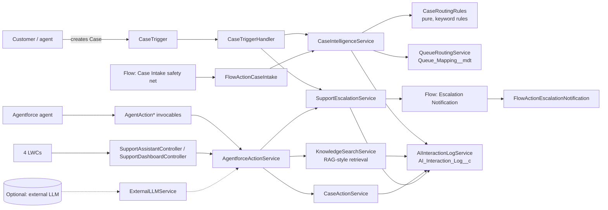

# Architecture

SmartSupport AI is a **deterministic-first** support automation core with optional AI layers. Rules decide priority, routing, escalation and authorization; AI (Agentforce, Prompt Builder, external LLM) may only *suggest*, and every suggestion is validated and logged.

## Layers
| Layer | Classes | Responsibility |
|---|---|---|
| Entry points | `CaseTrigger`, 2 record-triggered Flows, screen flow, 7 agent actions, LWC controllers | Thin; validate input, call services |
| Services | `CaseIntelligenceService`, `KnowledgeSearchService`, `SupportEscalationService`, `CaseActionService`, `CustomerContextService`, `QueueRoutingService`, `AIInteractionLogService` | Business logic, USER_MODE data access |
| Rules | `CaseRoutingRules` | Pure functions; no DML/SOQL; fully unit-testable |
| Config | `SupportConstants`, `Support_Setting__mdt`, `Queue_Mapping__mdt` | Thresholds and queue names; no hard-coded Ids |
| Audit | `AI_Interaction_Log__c` | Sanitised, PII-scrubbed log; Lookup to Case with SetNull so history can be retained |

## Decision precedence
Category: Security > Outage > Account Access > Billing > Shipping > Product Defect > Technical > General.
Escalation reason: Security > Widespread Outage > Customer Requested Human > Repeated AI Failure > Premium + High priority. The first reason is kept; later signals never overwrite it.

## Key design decisions
- **One invocable class per action** (Apex allows one `@InvocableMethod` per class).
- **Idempotency**: `Intake_Processed__c` and `Escalation_Notified__c` prevent reprocessing and duplicate notifications.
- **Insufficient knowledge**: retrieval returns `INSUFFICIENT_EVIDENCE` and never a fabricated answer; the caller is told to hand off to a human.
- **Optional modules** (Data Cloud, external LLM) sit outside the core manifest, so the core deploys on any org with Service Cloud and Knowledge not required for deployment.
